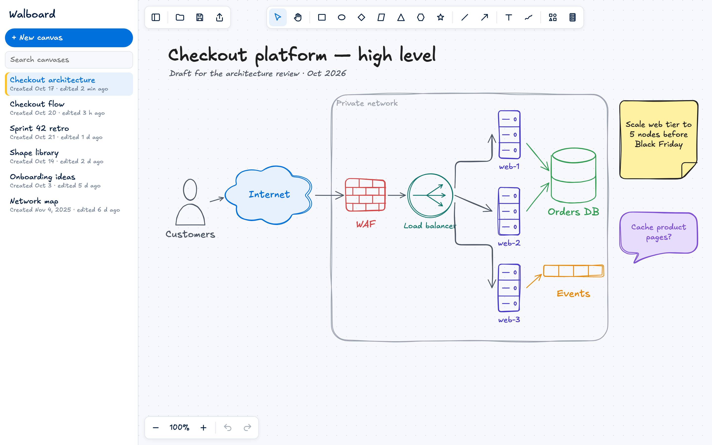
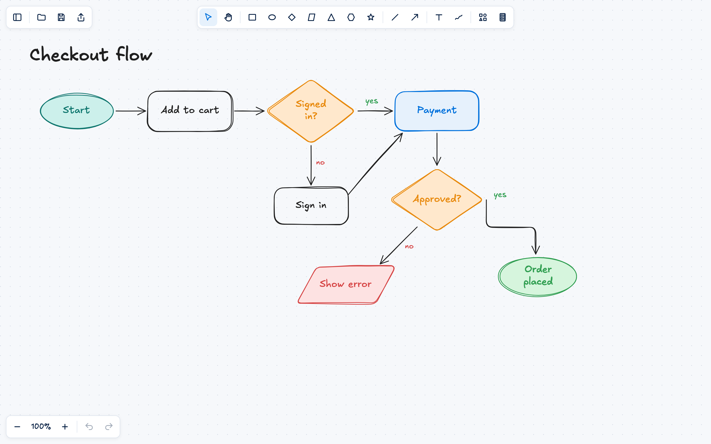
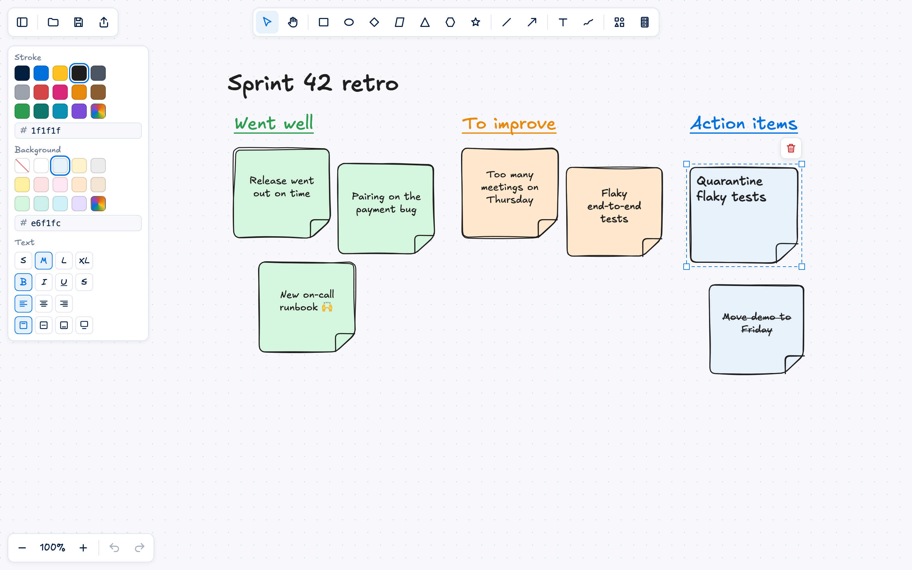
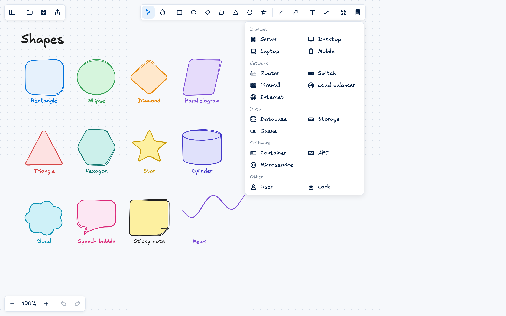

<p align="center">
  <picture>
    <source media="(prefers-color-scheme: dark)" srcset="docs/images/logo-dark.png" />
    
  </picture>
</p>

<p align="center">
  <b>✏️ A hand-drawn whiteboard for diagrams, architecture sketches and team rituals.</b><br />
  Zero dependencies. No build step. Opens straight from a file.
</p>

<p align="center">
  
  
  
  
</p>

<p align="center">
  <a href="#-quick-start">Quick start</a> ·
  <a href="#-features">Features</a> ·
  <a href="#-screenshots">Screenshots</a> ·
  <a href="#-how-to-use">How to use</a> ·
  <a href="#-how-it-works">How it works</a>
</p>

<p align="center">
  
</p>

---

## 🧭 Overview

Walboard is a lightweight whiteboard that runs entirely in the browser. Shapes, arrows and text are drawn with a
**hand-drawn stroke**, so diagrams look like quick sketches instead of polished slides — perfect for architecture
reviews, flowcharts, brainstorming and retrospectives.

It is written in **plain JavaScript, HTML and Canvas** with **no third-party code**: no frameworks, no npm packages,
no bundler. Download the folder, double-click `index.html`, and start drawing.

## 🚀 Quick start

```bash
git clone https://github.com/kcamposa/walboard.git
cd walboard
open index.html        # macOS  ·  Windows: start index.html  ·  Linux: xdg-open index.html
```

That's it — there is nothing to install or build. Any modern browser works; Chrome and Edge get the best file-saving
experience (see [Browser support](#-browser-support)).

> **Tip:** you can also serve the folder from any static web server if you prefer a URL over a local file.

## ✨ Features

| | |
|---|---|
| 🖊️ **Hand-drawn style** | Every shape is traced with slightly wavy, double strokes. Each element keeps its own "handwriting", so it never jitters when the canvas redraws. |
| 🔷 **28 shapes** | Rectangle, ellipse, diamond, parallelogram, triangle, hexagon and star in the toolbar; cylinder, cloud, speech bubble and sticky note under **More shapes**. |
| 🖥️ **Infrastructure icons** | 17 IT shapes under **Infrastructure**: server, desktop, laptop, mobile, router, switch, firewall, load balancer, internet, database, storage, queue, container, API, microservice, user and lock. |
| ➡️ **Lines & arrows** | Line, arrow, double arrow and elbow arrow (right-angled), plus a freehand pencil. |
| 🔤 **Text everywhere** | Free text anywhere, or double-click any shape to write inside it. Text wraps to the shape and moves with it. |
| 🅱️ **Text formatting** | Sizes S / M / L / XL, **bold**, *italic*, underline and ~~strikethrough~~, left / center / right alignment, and position inside the shape (top, middle, bottom) or as a caption below it. Format while you type. |
| 🎨 **Colors** | 14 stroke colors and 14 soft backgrounds — Walmart blue, yellow and navy first — each with its name on hover, a color picker, and hex codes (`#2563c9`, or the short `#f0a`). Pick a color before drawing, or recolor a selection. |
| ✋ **Editing** | Select, box-select, Shift-click to add, move, resize from the corners, delete, and up to 100 steps of undo / redo. |
| 🔍 **Infinite canvas** | Pan with the mouse wheel, two fingers or the Hand tool; zoom from 10% to 500% with pinch or the zoom buttons. |
| 🗂️ **Canvases panel** | Keep many boards side by side, like chats in a sidebar: create, rename, search, delete and switch. Each one shows when it was created and last edited. |
| 💾 **Files & export** | Every canvas saves itself in the browser. Save / open `.walboard` files to back up or share, and export the whole board — or just the selection — as a high-resolution PNG. |

## 📸 Screenshots

<table>
  <tr>
    <td width="50%">
      <br />
      <sub><b>Flowcharts</b> — diamonds for decisions, elbow arrows, colors and labels.</sub>
    </td>
    <td width="50%">
      <br />
      <sub><b>Retros & brainstorming</b> — sticky notes with formatted text and the style panel.</sub>
    </td>
  </tr>
  <tr>
    <td colspan="2">
      <br />
      <sub><b>Shape library</b> — every shape with the hand-drawn stroke, and the Infrastructure menu.</sub>
    </td>
  </tr>
</table>

## 🖱️ How to use

| To… | Do this |
|---|---|
| Draw a shape | Pick it in the toolbar and drag on the canvas. Hold **Shift** for a perfect square / circle or a straight 15° line. |
| Write text | Pick **Text** and click anywhere. Click outside the text (or press **Esc**) to finish. |
| Write inside a shape | **Double-click** the shape. Leave the text empty to remove it. |
| Select | Use **Select**: click a shape, drag a box around several, or **Shift-click** to add / remove. |
| Move / resize | Drag the selection, or drag one of its corner handles (**Shift** keeps the proportions). |
| Delete | Click the red trash button above the selection. |
| Change colors & text style | Use the panel on the left. It shows up while drawing, typing or when something is selected. |
| Pan / zoom | Mouse wheel or two fingers to pan, pinch to zoom, or the **− 100% +** buttons (click the percentage to reset). |
| Manage canvases | Use the panel on the left: **+ New canvas**, search, and hover a canvas to rename or delete it. Hide the panel with the first button of the top-left bar. |
| Save / open / export | Top-left bar: **Open** a `.walboard` file (it becomes a new canvas), **Save** to a file, **Export** as PNG. |

### ⌨️ Keyboard

Walboard is designed to be used with the mouse — on purpose, there are almost no shortcuts:

| Key | Action |
|---|---|
| `Esc` | Go back to the **Select** tool. While typing, it also finishes and selects the text. |
| `Enter` | Confirm a field (canvas name, hex color). Inside a text, it adds a new line. |
| `Shift` | While drawing or resizing: keep proportions and snap angles. While selecting: add or remove. |

## 💾 Where your work lives

- **Canvases** are saved automatically in the browser's local storage after every change. They stay on that computer
  and that browser only — clearing the site data removes them, so **save important boards to a file**.
- **`.walboard` files** are plain JSON, easy to version, diff or share:

```json
{
  "type": "walboard",
  "version": 1,
  "elements": [
    {
      "id": "el-1729700000000-1",
      "type": "rectangle",
      "x": 120, "y": 80, "width": 200, "height": 120,
      "strokeColor": "#2563c9", "fillColor": "#d4e8fb", "strokeWidth": 2,
      "seed": 1736541,
      "label": "API gateway", "fontSize": 20, "bold": true
    }
  ],
  "view": { "x": 0, "y": 0, "zoom": 1 }
}
```

- **PNG exports** use a white background and twice the screen resolution, and include text placed below shapes.

## 🗂️ Project structure

```text
walboard/
├── index.html              # The app: open it in a browser
├── css/
│   ├── styles.css          # Layout, panels, toolbar and theme colors
│   └── fonts.css           # Excalifont, embedded so it works from file://
├── fonts/excalifont/       # Font source files and their license (OFL.txt)
├── js/
│   ├── app.js              # Entry point: pointer input, tools, selection, camera, wiring
│   ├── elements.js         # Element model, text measuring and wrapping
│   ├── shapes.js           # Shape catalog: polygons, special and infrastructure shapes
│   ├── geometry.js         # Bounds, hit testing, move / scale, text layout inside shapes
│   ├── sketch.js           # The hand-drawn stroke: outlines, waves and double passes
│   ├── renderer.js         # Draws the scene, selection overlay and PNG exports
│   ├── toolbar.js          # Toolbar and its menus
│   ├── stylePanel.js       # Colors, hex codes and text formatting panel
│   ├── textEditor.js       # On-canvas text editing
│   ├── sidebar.js          # Canvases panel
│   ├── canvases.js         # Canvas storage (localStorage)
│   ├── history.js          # Undo / redo
│   └── files.js            # .walboard files and PNG downloads
└── docs/images/            # README images
```

## 🏗️ How it works

- **No build, no modules.** The scripts are classic `<script>` tags that share a single `WB` namespace, so the app
  runs from `file://` without a server or a bundler.
- **One canvas, redrawn on demand.** Changes request a redraw on the next animation frame; the renderer paints the
  grid, every element and the selection overlay through a camera transform (pan + zoom).
- **The hand-drawn stroke.** Each outline is turned into points, pushed sideways by smooth random waves plus a fine
  jitter, and drawn twice with slightly different randomness. A fixed seed per element keeps the drawing stable.
- **Plain data.** Elements are plain objects; undo / redo stores snapshots of them, and files and storage use the same
  JSON format.

## 🌐 Browser support

| Browser | Status |
|---|---|
| Chrome / Edge | ✅ Full support. **Save** remembers the file of each canvas and writes to it directly. |
| Firefox / Safari | ✅ Supported. **Save** downloads the file instead of writing to the chosen one. |

## 🗺️ Roadmap

- [ ] Copy, paste and duplicate
- [ ] Arrows that stay attached to shapes
- [ ] Stroke width and line styles (dashed, dotted)
- [ ] Dark mode
- [ ] SVG export

## 🔤 Fonts

Walboard uses the **Excalifont** typeface, licensed under the
[SIL Open Font License 1.1](fonts/excalifont/OFL.txt). If it is not available, the interface falls back to the
handwritten fonts that come with the operating system.

## 📄 License

No license has been chosen yet. Until one is added, all rights are reserved by the author.
